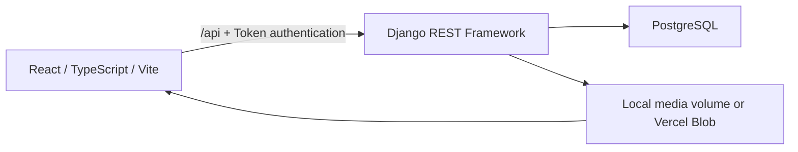

# Recipe Book — Full-Stack Recipe App

A personal recipe manager built with **React, TypeScript, Vite, Django REST
Framework, and PostgreSQL**. Register an account, keep your own recipe collection,
upload photos, organize meals with tags and ingredients, and update your profile.

**[Try the live website](https://recipe-book-test-flax.vercel.app)** ·
**[Source on the updates branch](https://github.com/adhamabaza/recipe-app-api/tree/updates)** ·
**[Vercel deployment guide](docs/VERCEL.md)**

The live site is hosted under the `adhamabaza` Vercel account. Visitors create a
Recipe Book account; a Vercel account is not required. The cloud website works
when the developer's computer and local Docker containers are off.

## Contents

- [Features](#features)
- [Architecture and stack](#architecture-and-stack)
- [Repository structure](#repository-structure)
- [Data model](#data-model)
- [Quick start](#quick-start)
- [Configuration](#configuration)
- [Using the website](#using-the-website)
- [API reference](#api-reference)
- [Deployment](#deployment)
- [Testing and CI](#testing-and-ci)
- [Troubleshooting](#troubleshooting)
- [Known limitations](#known-limitations)
- [Future work](#future-work)

## Features

- Registration, email/password login, logout, and protected pages.
- A dashboard showing only the authenticated user's recipes.
- Recipe creation, detail views, editing, and deletion with confirmation.
- Recipe image upload and display, including retry after a failed upload.
- Creation and assignment of tags and ingredients through recipe forms.
- Tag and ingredient listing, renaming, and deletion.
- Combined tag/ingredient filtering, with selections preserved in the URL.
- Profile updates for name, email, and password.
- Responsive layouts with loading, empty, success, and validation-error states.
- OpenAPI schema, Swagger UI, and Django administration.
- Docker development and deployment workflows, plus public Vercel hosting.

All application records persist in PostgreSQL. The browser stores the
authentication token, not recipe or account records.

## Architecture and stack



| Layer | Technologies |
| --- | --- |
| Frontend | React 19, TypeScript 5.9, Vite 7, React Router 7, plain CSS |
| API | Django REST Framework, custom email-based user model, DRF token authentication |
| Database | PostgreSQL; Neon Free plan for the hosted test site |
| Images | Docker media volume locally; public Vercel Blob in the cloud |
| Local infrastructure | Docker Compose, PostgreSQL 13, nginx, uWSGI |
| Cloud infrastructure | Vercel Services, Python 3.12, Node 24 |
| Verification | Django tests, Vitest, Testing Library, Playwright, ESLint, Flake8 |
| CI | GitHub Actions frontend and backend jobs |

Two Python dependency profiles are intentionally kept separate:

- **Original Docker backend:** Python 3.9 / Django 3.2, configured by the root
  `requirements.txt` and `app.settings`.
- **Vercel backend:** Python 3.12 / Django 5.2 LTS, with pinned dependencies in
  `app/pyproject.toml` and settings in `app.settings_vercel`.

Vite proxies API and media requests in development. The Docker deployment uses
nginx, and Vercel uses service routing. Each setup presents the frontend and API
through one browser origin, avoiding a separate CORS setup.

## Repository structure

```text
app/
  app/                 Django settings, URLs, WSGI/ASGI entrypoints
  core/                User, Recipe, Tag, Ingredient models and migrations
    blob_storage.py    Optional Vercel image storage
    test/              Model, admin, command, and cloud-storage tests
  recipe/              Recipe, tag, ingredient, and image APIs
  user/                Registration, token, and profile APIs
  pyproject.toml       Cloud Python dependencies
frontend/
  src/
    api.ts             Shared typed API requests and authentication storage
    auth.tsx           Session restoration and protected routes
    types.ts           API data contracts
    pages/             Account, dashboard, recipe, and library screens
  e2e/                 Real-backend Playwright workflows
  Dockerfile           Development and static production frontend images
  VERIFICATION.md      Original local implementation verification record
docs/VERCEL.md         Hosting configuration, redeployment, and live checks
docs/LINKEDIN_POST.md  Ready-to-edit project announcement
proxy/                Deployment nginx configuration
scripts/              Docker startup and optional cloud test helper
.github/workflows/    CI checks
docker-compose.yml    Development stack
docker-compose-deploy.yml
vercel.json           Public service routing and cloud build configuration
```

## Data model

| Model | Main fields and relationships |
| --- | --- |
| User | Unique email, name, hashed password, account/admin flags |
| Recipe | Owner, title, cooking time, decimal price, description, source link, image |
| Tag | Owner and name; many-to-many relationship with recipes |
| Ingredient | Owner and name; many-to-many relationship with recipes |

Recipe, tag, and ingredient querysets are filtered by the authenticated user.
Nested recipe payloads find or create attributes within that user's records.
Another user cannot retrieve, modify, delete, or upload images to the owner's
recipe API resources.

## Quick start

### Requirements

- Git and Docker Desktop, or Docker Engine with the Compose plugin.
- Node.js **22.12+ in the 22.x series, or Node 24**, with npm, if running frontend
  commands outside Docker. Node is not required on the host for Docker-only use.

### 1. Get the complete application

For a new checkout:

```sh
git clone --branch updates https://github.com/adhamabaza/recipe-app-api.git
cd recipe-app-api
```

If you already have this workspace, use it directly.

### 2. Start the development stack

From the repository root:

```sh
docker compose up --build
```

Compose starts PostgreSQL, waits for it, applies migrations, starts Django, and
runs Vite with hot reload.

| Address | Purpose |
| --- | --- |
| http://localhost:5173/ | Complete development website |
| http://localhost:8000/api/docs/ | Swagger API documentation |
| http://localhost:8000/api/schema/ | OpenAPI schema |
| http://localhost:8000/admin/ | Django administration |

The development API root redirects to Swagger. The website uses port 5173,
which proxies API, media, and admin requests to Django.

### Existing deployment already using port 8000

Keep it running and start a separate development project:

```powershell
$env:API_PORT = '8001'
docker compose -p recipe-local up --build
```

The website remains on port 5173; the development API uses port 8001. This
project gets its own database volumes. Reuse the same project name on later
starts to retain its data. Do not switch an existing deployment project to the
development Compose file: they use different database volumes.

### Run Vite on the host

In one terminal:

```sh
docker compose up --build app db
```

In another terminal:

```powershell
cd frontend
npm.cmd ci
npm.cmd run dev
```

On macOS/Linux, use `npm` in place of `npm.cmd`. On Windows, `npm.cmd`
works when PowerShell blocks `npm.ps1`; changing the execution policy is unnecessary.

### Stop services and retain data

Press Ctrl+C, then:

```sh
docker compose down
```

Named volumes retain PostgreSQL data and uploaded media. Do not use
`docker compose down -v` when you need to preserve them.

Create a local administrator with:

```sh
docker compose exec app python manage.py createsuperuser
```

## Configuration

### Development

The default Compose configuration works without creating a new environment file.

| Variable | Default | Purpose |
| --- | --- | --- |
| `API_PORT` | `8000` | Published development API port |
| `DB_HOST` | `db` | Database service inside Compose |
| `DB_NAME` | `Devdb` | Local development database |
| `DB_USER` | `devuser` | Development database user |
| `DB_PASSWORD` | `changeme` | Development-only password |
| `DEBUG` | `1` | Django development mode |
| `ALLOWED_HOSTS` | `localhost,127.0.0.1,[::1],app` | Includes Vite's internal Docker proxy host |

These credentials are local defaults, not production credentials.

### Frontend

Copy `frontend/.env.example` to `frontend/.env.local` only if that file does not
already exist, then restart Vite after changes.

| Variable | Default | Purpose |
| --- | --- | --- |
| `API_PROXY_TARGET` | `http://127.0.0.1:8000` | Vite's backend target; Compose sets `http://app:8000` |
| `VITE_API_BASE_URL` | `/api` | Browser API prefix |
| `VITE_MAX_IMAGE_BYTES` | `10485760` | Client upload limit; Vercel sets `4194304` |

An absolute API base URL requires CORS support on the target backend. The
supported shared-origin configuration uses `/api`. Docker media URLs are
normalized to the public API origin; public Blob URLs are preserved.

Never put passwords, signing keys, database URLs, or Blob tokens in `VITE_*`
variables: those values are exposed to the browser.

### Docker deployment

For a new deployment, copy `.env.example` to `.env` without overwriting an
existing file, and replace its placeholders:

| Variable | Purpose |
| --- | --- |
| `DB_NAME`, `DB_USER`, `DB_PASS` | Deployment database credentials |
| `DJANGO_SECRET_KEY` | Unique, private signing key |
| `DJANGO_ALLOWED_HOSTS` | Comma-separated public hostnames |

For an existing database volume, keep its original credentials. PostgreSQL's
initialization environment variables do not change existing roles or passwords.

### Vercel

The public test site has a separate managed database and image store. Its
configuration names are documented in `app/.env.vercel.example`; full setup
and deployment details are in [docs/VERCEL.md](docs/VERCEL.md).

`.env` files, pulled cloud credentials, `.vercel/`, caches, dependencies,
build outputs, and test artifacts are excluded from Git. Configuration templates
contain placeholders only.

## Using the website

1. Register and log in using your email and password.
2. Select **New recipe** and enter its title, cooking time, price, and details.
3. Add tag/ingredient names or choose existing attributes. New names are created
   when the recipe is saved.
4. Optionally choose an image. The recipe saves first, followed by its upload.
   If uploading fails, retry without creating a duplicate recipe.
5. Open the saved recipe to view its photo and details, edit it, or delete it.
6. Use dashboard checkboxes to combine tag and ingredient filters.
7. Rename/delete attributes on their dedicated pages; deleting one removes its
   assignments while keeping the recipes.
8. Update account details on **Profile**. Leave password fields blank to keep
   the current password.

The local proxy accepts request bodies up to 10 MB, including multipart overhead.
The hosted site accepts recipe images up to **4 MB** to fit Vercel's request
limit. Images are served through public URLs, matching the original backend's
media behavior.

## API reference

All endpoint paths include their trailing slash.

| Method | Endpoint | Purpose |
| --- | --- | --- |
| POST | `/api/user/create/` | Register |
| POST | `/api/user/token/` | Obtain a DRF token |
| GET, PATCH, PUT | `/api/user/me/` | View/update the authenticated profile |
| GET, POST | `/api/recipe/recipes/` | List own recipes or create one |
| GET, PATCH, PUT, DELETE | `/api/recipe/recipes/{id}/` | Manage an owned recipe |
| POST | `/api/recipe/recipes/{id}/upload-image/` | Upload multipart field `image` |
| GET | `/api/recipe/tags/` | List own tags |
| PATCH, PUT, DELETE | `/api/recipe/tags/{id}/` | Rename/delete an owned tag |
| GET | `/api/recipe/ingredients/` | List own ingredients |
| PATCH, PUT, DELETE | `/api/recipe/ingredients/{id}/` | Rename/delete an owned ingredient |

Use Swagger at `/api/docs/` for interactive requests and the schema at
`/api/schema/` for the complete API contract.

### Authentication

Register with `name`, `email`, and `password`. Passwords have a minimum
length of 5 characters in the existing API serializer and are hashed by Django.

Log in with:

```json
{
  "email": "cook@example.com",
  "password": "your-password"
}
```

The response contains `{"token": "..."}`. Send authenticated requests with:

```http
Authorization: Token YOUR_TOKEN
```

The frontend checks a saved token against `/api/user/me/` at startup. A 401
clears authentication and redirects to login. Network failures offer retry
without discarding the token. Logout clears local state and updates other tabs.

Tokens have **no automatic expiration** in this backend. There is no server
logout/revocation endpoint; local logout does not invalidate an already-issued
token on the server. Password updates retain the backend's existing token behavior.

### Recipe payload

```json
{
  "title": "Vegetable soup",
  "time_minutes": 25,
  "price": "7.50",
  "description": "Simmer the vegetables until tender.",
  "link": "https://example.com/soup",
  "tags": [{"name": "Weeknight"}],
  "ingredients": [{"name": "Carrot"}, {"name": "Potato"}]
}
```

Title and attribute names have a maximum length of 255 characters. Cooking time
is an integer. Price has five total digits and two decimal places, so its range
is -999.99 to 999.99. The current backend also permits negative cooking times;
the frontend follows its existing validation rather than introducing a new rule.
Description and source link are optional. Links are stored as text; only HTTP(S)
URLs become clickable in the frontend.

Recipe lists omit description/image fields; detail requests retrieve them.
Upload images separately as multipart form data rather than nested JSON.

Tags and ingredients are nested name objects, not ID arrays. The backend
finds or creates each name for the current user. Send `[]` to clear a recipe's
assignments. Attribute endpoints do not support standalone creation.

### Filtering

```text
GET /api/recipe/recipes/?tags=1,2&ingredients=3,4
GET /api/recipe/tags/?assigned_only=1
GET /api/recipe/ingredients/?assigned_only=1
```

Recipes match any chosen ID within each attribute group, and both groups when
tags and ingredients are combined. Results remain restricted to the current user.
Attribute lists support `assigned_only=0` or `1`.

## Deployment

### Docker / nginx / uWSGI

Use the deployment file independently:

```sh
docker compose -f docker-compose-deploy.yml up -d --build
```

Open http://localhost:8000/ when the configured hosts allow localhost.
nginx serves the built frontend, proxies the API/admin paths to uWSGI on port
9000, and serves static/media files from the persistent volume.

Do not merge development and deployment Compose files. Development uses
`dev-db-data`; deployment uses `postgres-data`. Their static/media volumes
are separate too. Backend-only development remains available with
`docker compose up --build app db`.

### Vercel / Neon / Blob

The live site uses native Django hosting and Vercel Services with one public
origin. The backend build applies migrations; Vercel collects static assets.
Recipe images are stored in Blob instead of the function's ephemeral filesystem.

To redeploy from this checkout after verifying the account/project:

```powershell
npx.cmd --yes vercel@65.9.0 whoami --format json
npx.cmd --yes vercel@65.9.0 project inspect --non-interactive --scope adhamabazas-projects
npx.cmd --yes vercel@65.9.0 deploy --prod --yes --scope adhamabazas-projects --project recipe-book-test
```

On another machine, authenticate and link to the intended project first.
See [the hosting guide](docs/VERCEL.md) for environment requirements and commands.
GitHub pushes and Vercel deployments are separate unless Git auto-deployment is
explicitly configured. The current live site was published through the CLI.

## Testing and CI

### Backend

```sh
docker compose run --rm app sh -c "python manage.py wait_for_db && python manage.py test"
docker compose run --rm app sh -c "flake8"
```

### Frontend

From `frontend/`:

```powershell
npm.cmd ci
npm.cmd run typecheck
npm.cmd run lint
npm.cmd test
npm.cmd run build
```

Preview a production build locally with `npm.cmd run preview` at
http://localhost:4173/. The configured preview proxy still needs the backend.

### Real API and browser integration

Start the complete development stack, then run from `frontend/`:

```powershell
npx.cmd playwright install chromium --no-shell
npm.cmd run test:e2e
```

For the public test site:

```powershell
$env:E2E_BASE_URL = 'https://recipe-book-test-flax.vercel.app'
npm.cmd run test:e2e
Remove-Item Env:E2E_BASE_URL
```

API-only checks need no browser:
`npm.cmd run test:e2e -- --grep "real API"`.

These tests use actual accounts, PostgreSQL records, and image storage. They
cover account flows, CRUD, uploads, attribute management, filtering, profile and
password updates, refresh persistence, invalid authentication, and two-user
isolation. Successful runs delete their recipes and attributes. Test accounts,
uploaded images, and records from failed tests may remain. Use a test database.

### Recorded results

| Check | Recorded outcome |
| --- | --- |
| Linux Docker/PostgreSQL backend suite | 73 passed |
| Frontend unit tests | 13 passed |
| TypeScript, frontend ESLint, production builds | Passed |
| Public Vercel API and browser integration | Passed |
| New cloud-storage Python files | Passed targeted Flake8 |
| Full existing backend Flake8 | Existing formatting/unused-import failures remain |
| Cloud-dependency backend suite run from Windows | 72 passed; 1 existing POSIX-path assertion failed |

The Windows assertion expects forward slashes while `os.path.join` returns
backslashes. It passes in Linux Docker, and actual hosted image upload passed.
Full details and environment-specific issues are recorded in
[the local verification report](frontend/VERIFICATION.md) and
[the cloud verification guide](docs/VERCEL.md).

GitHub Actions runs frontend lint/unit tests/build and the existing backend
tests/Flake8 on pushes. The known legacy backend lint issues can make the backend
job fail; they are not masked or described as passing. Browser tests run
separately against a running stack.

## Troubleshooting

**Docker is not on PATH on Windows:** for a per-user Docker Desktop install:

```powershell
$env:PATH = "$env:LOCALAPPDATA\Programs\DockerDesktop\resources\bin;$env:PATH"
```

**Port 8000 is busy:** use the separate `recipe-local` project and
`API_PORT=8001` example above. Vite uses a strict port; stop the conflicting
frontend if port 5173 is already occupied.

**Frontend dependencies are stale in Docker:** after a lockfile change, run
`docker compose run --rm frontend npm ci`, then restart the frontend. Its
dependency volume is separate from database volumes.

**Database role/password errors:** PostgreSQL initialization variables only
apply to an empty data directory. Use the existing volume's original credentials.
Connect as its original administrator, inspect roles with `\du` and databases
with `\l`, then correct configuration. Do not delete a volume to fix credentials.

**nginx returns 502:** inspect startup and health-check logs:

```sh
docker compose -f docker-compose-deploy.yml ps -a
docker compose -f docker-compose-deploy.yml logs --tail=80 app proxy db
```

Fix the first database, migration, or static-collection error. uWSGI starts after
those steps succeed. Rebuild/recreate the relevant services after correcting
configuration.

**Hosted routes or media fail:** use the root service routing configuration and
the dedicated cloud settings, rather than deploying the frontend alone. Blob
requires its connected credentials and public store origin. Details are in
[docs/VERCEL.md](docs/VERCEL.md).

## Known limitations

- The original Docker dependency profile contains older Django/Python versions;
  the cloud profile is separate. The project is a learning/test deployment,
  not a claim of a completed production-security review.
- Token expiry, server-side logout, account deletion, password reset/email
  verification, and automatic deletion of unreferenced image files are not
  implemented.
- Images use public delivery URLs even though recipe API metadata is user-scoped.
- Existing backend Flake8 issues remain. The last complete frontend dependency
  audit reported 12 moderate advisories in development lint tooling; the runtime
  dependency audit reported none at that check.
- The hosted site has its own data and is subject to the hosting/storage plans'
  limits. It does not expose the developer's local Docker database.

## Future work

Possible later additions include recipe recommendations, RAG, or another AI/ML
feature, but no feature has been selected or implemented. There are no placeholder
AI screens or AI provider dependencies in this implementation.

The API layer, page components, and cloud settings remain separated so future
features can be added without mixing them into the existing authentication and
recipe flows.

---

Project by **Adham Abaza**.
